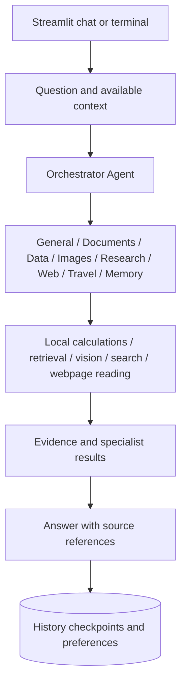

# AI Agent

A local, goal-based multi-agent assistant built with Python, LangChain, LangGraph and Streamlit. One chat supports questions, uploaded documents, spreadsheet calculations, image understanding, public-link reading, web research and travel planning.

## Current document retrieval and routing

Document questions use the official `raganything` package: approved MinerU Cloud
parsing → `RAGAnything.insert_content_list()` → LightRAG graph/vector indexing →
`RAGAnything.aquery(mode="hybrid")` → evidence-grounded document response.
Local parsing, when explicitly configured, uses the upstream `process_document_complete()`
path. Text/vision models use the configured API providers; cloud embeddings use Google.
Ollama is not used. Knowledge graph use is internal and is part of the official framework.
The obsolete FAISS-only adapter has been removed.

Unrelated/external factual questions use the Internet Agent and actual web search,
even while documents are attached. A document evidence miss can trigger a labeled
internet follow-up; document-only requests never silently switch sources. Greetings,
calculations, personal memory and composition retain their suitable specialist paths.
See [the current flow guide](docs/Current_RAG_Flow.md).

## Architecture



LangChain supplies model and tool interfaces; LangGraph manages stateful agent/tool loops. Specialist roles may share an underlying model. Calls, handoffs and searches are bounded. A failed API cannot be guaranteed to recover even when compatible backups are configured.

## Features

- Document questions using readable PDF text, Word/slide/text extraction, exact PDF pages and local BM25 retrieval.
- Excel/CSV inspection and allowlisted local Pandas calculations: sum, mean, min, max, count and optional grouping.
- Image understanding through compatible configured vision services.
- Tavily web search with SerpApi backup and SerpApi travel searches.
- Actual reading of supplied public URLs with BeautifulSoup, public-address validation, robots.txt checks and bounded caching.
- Persistent SQLite chat history, checkpoints and user preferences.
- Automatic compatible model fallbacks and bounded context to control usage.

## Requirements

Windows and Python 3.11 or newer; development and packaging checks used Python 3.13. Internet access and valid API credentials are needed for model/API features. Dependency versions are not fully pinned, so a fresh installation may resolve different versions.

## Quick start on Windows

Extract the project anywhere. Open PowerShell in the directory containing this README and requirements.txt. No fixed drive or project-directory name is required.

```powershell
py --version
py -3 -m venv .venv
.\.venv\Scripts\python.exe -m pip install --upgrade pip
.\.venv\Scripts\python.exe -m pip install -r requirements.txt
Copy-Item -LiteralPath .env.example -Destination .env
notepad .env
```

Use Python 3.11 or newer. Copy the example only for a fresh setup; preserve an existing .env. Add your own API keys locally, one complete VARIABLE=value per line. Never commit credentials.

```powershell
.\.venv\Scripts\python.exe -m streamlit run app/ui/streamlit_app.py
```

Open the local URL printed by Streamlit, normally http://127.0.0.1:8502/. If occupied, append `--server.port 8503`. Stop with Ctrl+C. Direct executable paths avoid PowerShell activation-policy issues.

Optional terminal interface:

```powershell
.\.venv\Scripts\python.exe main.py
```

## Credentials and models

| Setting | Purpose |
| --- | --- |
| LLM_PROVIDER=groq and GROQ_API_KEY | Default startup and primary text/orchestration |
| GROQ_MODEL | Defaults to openai/gpt-oss-20b |
| GOOGLE_API_KEY and GEMINI_MODEL | Compatible Gemini fallback; set LLM_PROVIDER=gemini to make it primary |
| OPENROUTER_API_KEY | Separate spreadsheet planning and compatible text/image backups |
| TAVILY_API_KEY | Primary web search |
| SERPAPI_API_KEY | Search backup and travel results |

See .env.example for configured model IDs. MODEL values contain model names, not API keys. Model availability, free-tier eligibility and quotas depend on the provider. openrouter/free is a router and may select different underlying models. Scraping does not require a new API key; generated summaries still use an existing model.

## Validation

```powershell
.\.venv\Scripts\python.exe -B -m unittest discover -s tests -q
```

Try `Calculate 125 * 37 + 450 / 9.` (expected 4675), request an uploaded PDF first-page title, compare an uploaded spreadsheet total with Excel SUM, or summarize https://www.python.org/doc/ in one line. External API success is separate from offline unit tests. Two tests require specific optional files under tests/fixtures and are skipped when absent; see tests/fixtures/README.md.

## Source map

- app/ui/streamlit_app.py: unified interface and per-chat session wiring.
- app/multi_agent/system.py: active orchestrator, specialists and result checks.
- app/llm/: model construction and compatible fallback handling.
- app/attachments/: format routing, normalization and image analysis.
- app/rag/documents.py: local extraction, BM25 and exact-page retrieval.
- app/spreadsheet/: table inspection, planning and local calculations.
- app/integrations/: webpage, web search and travel integrations.
- app/history/ and app/memory/: local persistent history and preferences.
- app/agent/ and app/tools/: conversation graph and shared tools.
- tests/: regression tests.
- docs/AI_Agent_Technical_Documentation_Portable.docx: architecture/operations snapshot before the optional multimodal integration.
- docs/MinerU_RAGAnything_Implementation.md: current optional multimodal architecture, setup, retention and verification.

## Storage and limitations

SQLite files are generated under data/. Readable attachment content is saved with each chat in chat_history.sqlite3: extracted document chunks, spreadsheet data and normalized images. Reopening the same chat restores these without reparsing or repeating indexing API calls. Original upload binaries are not retained by this snapshot. Optional MinerU/RAG-Anything mode also persists original sources and derived indexes under data/multimodal_rag and restores their retrieval references. Clear attachments removes the chat snapshot; deleting a chat deletes its attachment snapshot too. Optional RAG artifacts on disk are retained separately. Chats saved before this feature require a one-time reupload if their attachments are no longer in memory. Local profiles are not authenticated accounts. The app binds to 127.0.0.1 and is not a production authenticated multi-user service.

Uploads have size, page, row and format limits. Scanned PDFs may need OCR. Linked pages requiring login, CAPTCHA, JavaScript or restricted automated access may not be readable. Spreadsheet formulas are not arbitrarily recalculated. Gmail sending, bookings, payments, image generation and dedicated similar-image search are not implemented.

Selected text/images may be transmitted to configured external services. Review provider terms before submitting sensitive information. Never distribute .env, credentials, private data/ databases or virtual environments.

## GitHub upload

Extract the ZIP and upload its contents to a new repository; uploading only the ZIP does not expose the source as a browsable project. Include hidden files .gitignore, .env.example and .streamlit/config.toml. Exclude .env, data/, virtual environments and packaging output. If Git is installed, run from the extracted project directory:

```powershell
git init
git add .
git status
# Review staged files before committing. Do not include keys or private data.
git commit -m "Initial project import"
```

Then connect the repository to your own GitHub remote. This package does not publish or create a repository automatically. No open-source license is granted by this package; add a license if public reuse is intended.


## Optional MinerU and RAG-Anything

A real multimodal document backend is available in an isolated .venv-rag runtime. See [implementation and setup](docs/MinerU_RAGAnything_Implementation.md) for architecture, dependencies, processing limits, privacy changes and verification. Use scripts/setup_rag.ps1, then set DOCUMENT_RAG_BACKEND=raganything in the local .env and restart. The default example remains standard mode. Full spreadsheet calculations continue in Pandas; optional RAG table context contains only the first ten rows. Multimodal mode persists source/derived files under the excluded data/ directory.

For a concise explanation of the three integration modules and configured text/vision/embedding models, see [Anything RAG code map](docs/Anything_RAG_Code_Map.md).


## Larger document uploads

The former 200,000 extracted-character rejection has been removed from standard PDF/Word/text extraction and the Anything RAG adapter/worker. Full extracted text is split into retrieval chunks instead of truncating at that threshold. The model receives selected excerpts, not the entire document. Twenty-page PDF/Word regression fixtures over the former threshold are covered by tests/test_large_documents.py. Existing limits still apply: 10 MB uploads, at most 50 PDF pages, document-count and expanded archive limits, parser/model timeouts and supported formats. Restart the server after updating and reattach a previously rejected file.


### Optional MinerU Cloud parsing
Set `MINERU_API_TOKEN` in local `.env`, restart Streamlit, and explicitly enable
"Allow MinerU Cloud to process new uploads in this chat" in the sidebar.
Only then are new uncached files uploaded to MinerU Cloud. The default remains local.
Cloud parsing uses submit/upload/poll/download, retains structured page/media output,
and passes it to the same RAG-Anything indexing pipeline. A failed cloud request falls
back to local MinerU. Existing cached parse results are reused without a new upload;
clear and reattach in a new chat to try cloud parsing on an already indexed file.
Cloud quotas are account-dependent; this does not remove LLM quotas or parsing limits.


### Official RAG-Anything API mapping
The document pipeline imports the upstream pinned `raganything` package. Local ingestion
uses its `parse_document()` and `process_document_complete()` APIs. Approved cloud content
uses its `insert_content_list()` API; hybrid retrieval uses `aquery(mode="hybrid")`.
MinerU, LightRAG and text/vision/embedding models are framework dependencies.
See [the upstream alignment guide](docs/Anything_RAG_Official_Alignment.md) for exact
app-level differences and [the runnable example](examples/anything_rag_example.py).
The existing configured providers are retained; the upstream example's paid OpenAI
model choices are not silently enabled.


### Document query latency
Successful hybrid context is cached per document job and query on disk, and is invalidated
when that job's index-ready marker changes. A cache hit skips the query worker startup.
`RAG_QUERY_TIMEOUT_SECONDS` defaults to 40 seconds per uncached query worker; this is
not a total response-time guarantee. Indexing/parsing retain separate budgets. Failed
hybrid queries cool down for 60 seconds so repeated questions can use labeled local
source evidence without repeating the full wait. Overview requests finalize after
retrieved evidence rather than reopening another tool loop. Retrieval duration is
recorded in activity. MinerU Cloud accelerates the parsing stage only when opted in;
it does not remove graph-query, model, network or provider delays.


### Optional cloud document inference
Cloud support is implemented but is not enabled merely by adding a key. After explicit
approval to send complete files to MinerU Cloud and extracted text to Google, configure
`RAG_PROCESSING_MODE=cloud` and `RAG_EMBEDDING_PROVIDER=gemini` and enable the matching
sidebar consent checkbox. Cloud embeddings use gemini-embedding-001 with the existing
GOOGLE_API_KEY and normalized 768-dimensional vectors. Text/vision models already run
through configured remote providers. Cloud mode never silently starts local MinerU or
FastEmbed on failure. Plain text lookup remains a labeled lightweight fallback.

UI, graph/vector storage, orchestration and Pandas calculations still run locally;
this is not a hosted deployment. Cloud quotas and network delays still apply.
New cloud embedding indexes use a separate directory; old 384-dimensional local
indexes must be rebuilt via Document processing status before hybrid querying with
cloud embeddings. Vectors from different embedding models must never be mixed.
