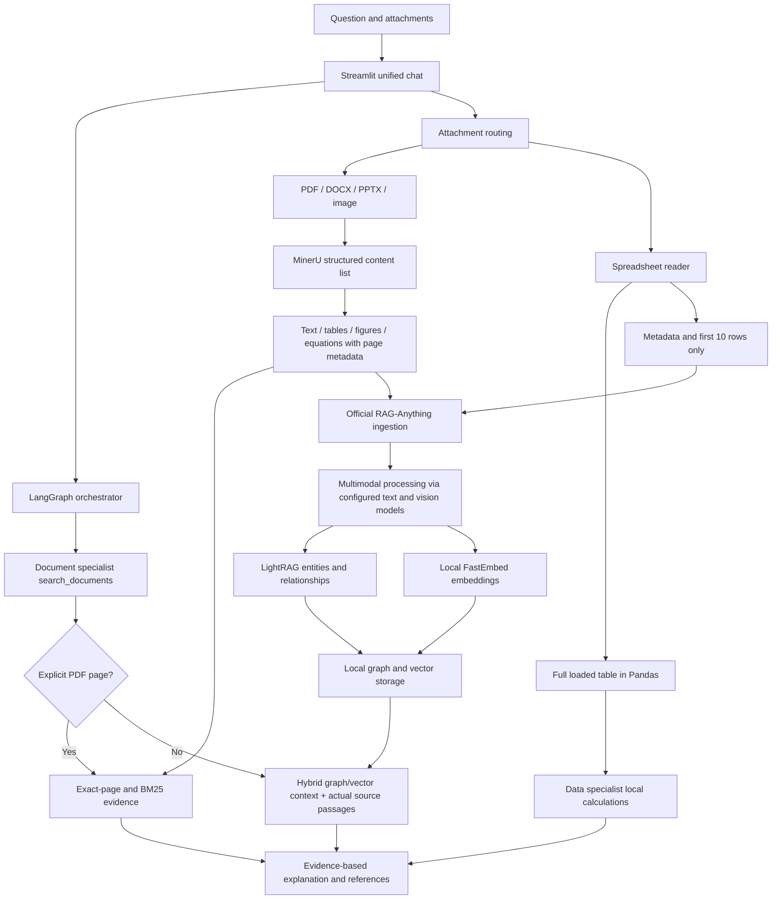

# MinerU and RAG-Anything integration

## What changed

The existing LangGraph orchestrator and specialist agents remain the application control plane. Document processing now has an optional real HKUDS RAG-Anything backend, using MinerU structured parsing, local embeddings and LightRAG graph/vector storage. Existing exact-page/BM25 evidence remains available and exact spreadsheet arithmetic stays in Pandas.

The feature is enabled on this installation with DOCUMENT_RAG_BACKEND=raganything. A fresh installation starts with standard in .env.example until the optional runtime is installed and enabled.

## Architecture



## Why each component exists

- MinerU is the parser: it identifies document content and preserves structure/page locations. It is not the chat LLM or an embedding model.
- RAG-Anything is the multimodal ingestion/query framework. It processes content lists and uses LightRAG to build retrieval structures.
- LightRAG stores chunks, extracted entities and relationships, and supports hybrid graph/vector retrieval. The current local defaults generate GraphML/JSON storage through NetworkX and NanoVectorDB; this integration does not require FAISS or a hosted vector database.
- FastEmbed runs BAAI/bge-small-en-v1.5 locally through ONNX, producing 384-dimensional vectors. No embedding API key is needed. Model weights download on first use. This English embedding model may be weaker for Hindi-only semantic matching; lexical/source fallback remains important.
- Existing LangChain model adapters provide text and vision callbacks. Provider fallbacks remain compatible and bounded.
- LangGraph still chooses the specialist/tool workflow. RAG-Anything is a knowledge capability, not a replacement for the orchestrator.
- Pandas retains full-table arithmetic. A retrieved preview or model-generated graph must never be treated as an exact tax total.

## Detailed processing sequence

1. The UI accepts a supported file through the existing upload interface.
2. Attachment routing checks size/format and selects a document, image or spreadsheet path.
3. For documents the adapter hashes the source and creates a job directory inside a random per-chat namespace. Different chats do not discover each other’s indexes automatically.
4. A subprocess in .venv-rag runs MinerU through RAG-Anything’s MineruParser. API keys are never passed as CLI arguments or request JSON.
5. MinerU returns content blocks. Zero-based page_idx values become one-based source page references. Text, table bodies/captions and equations feed bounded local chunks.
6. Image paths are accepted only when they refer to generated files inside the current job directory.
7. Official RAGAnything.insert_content_list processes the blocks. Text/vision callbacks describe supported modalities and extract entities/relationships; local embeddings build vector storage.
8. A completed index gets an index_ready.json marker only after insertion returns successfully. Failures are shown as parsed_only/local fallback, not a completed multimodal index.
9. At query time search_documents preserves exact PDF page requests. General document queries can add RAG-Anything hybrid retrieval context to actual local source passages.
10. The existing Document Agent explains returned evidence. Graph-derived context is supplementary, not proof of a fabricated page or exact spreadsheet calculation.

## File and format handling

- Readable and scanned PDF: MinerU parsing/OCR is available subject to model availability and extraction quality; encrypted files and more than 50 PDF pages are rejected.
- DOCX/PPTX: the pinned RAG-Anything parser uses Office-to-PDF conversion and may need LibreOffice on PATH. If that is unavailable, the current local text reader remains a fallback. This must not be described as successful MinerU Office parsing.
- Images: existing direct vision remains available. MinerU can add document evidence when parsing yields readable content. An image without useful OCR/captions may still have a direct vision answer without a completed knowledge index.
- Excel/CSV and other supported tables: the full table stays in Pandas. Only schema/row count and the first 10 rows are inserted for supplementary semantic questions. It is not a full-workbook RAG index or a replacement for calculate_table.
- Plain text/code continues through the existing local reader; this change does not claim every file format passes through MinerU.
- Audio/video, arbitrary archives, unrestricted code execution and every proprietary format are not enabled by this integration.

## Modules added or changed

| File | Responsibility |
| --- | --- |
| app/rag/anything_rag.py | Backend factory, scoped worker client, MinerU page chunks, RAG queries, fallback/status and retry |
| app/rag/anything_rag_worker.py | Isolated parse/index/query dispatcher and source-page handling |
| app/rag/anything_rag_models.py | Clearly separated text API, vision API, local embedding callbacks and official framework construction |
| requirements-rag.txt | Separate optional dependency set; concrete framework versions |
| scripts/setup_rag.ps1 | Create optional runtime and install/check dependencies |
| app/attachments/store.py | Feed supported documents/images and bounded table previews into the selected backend |
| app/ui/streamlit_app.py | Create backend per chat, show honest processing state and retry incomplete indexing |
| main.py | Select the configured document backend for terminal PDF ingestion |
| app/multi_agent/system.py | Permit labeled multimodal retrieval context without weakening source/page/calculation rules |
| .env.example | Optional backend and resource flags; no real credentials |
| tests/test_multimodal_rag.py | Regression checks for page scope, source evidence, path confinement, fallback and state |

## Windows setup

Run from the project directory containing requirements.txt. The current base app environment can remain unchanged.

```powershell
powershell -ExecutionPolicy Bypass -File scripts/setup_rag.ps1
```

This policy override applies only to that script process. The script reuses an existing app interpreter when available; otherwise it selects standard Python 3.13, avoiding the separate free-threaded Python build. For another supported standard version, adjust the launcher selector. Alternatively create the environment and run pip manually:

```powershell
py -3.13 -m venv .venv-rag
.\.venv-rag\Scripts\python.exe -m pip install -r requirements-rag.txt
.\.venv-rag\Scripts\python.exe -m pip check
```

Add these non-secret flags to the local .env, retaining existing keys:

```dotenv
DOCUMENT_RAG_BACKEND=raganything
MINERU_DEVICE=cpu
RAG_MAX_MODEL_CALLS=16
```

Start the existing UI environment:

```powershell
.\.venv-standard\Scripts\python.exe -m streamlit run app/ui/streamlit_app.py
```

If the app environment was named .venv instead, use its interpreter. Open the URL printed by Streamlit (the current project config uses local port 8502). Restart the server after changing flags; old attachments may need reattachment. RAG_PYTHON is an optional interpreter override; by default the adapter finds the project’s .venv-rag interpreter.

The pinned stack is RAG-Anything 1.4.3, MinerU 3.4.5, LightRAG 1.4.16 and FastEmbed 0.9.1. MinerU 4.x exists, but this integration uses the verified 3.x combination rather than assuming CLI/API compatibility. Install LibreOffice separately if Office conversion is required. The first parse/embedding run downloads public weights and can take several minutes; CPU parsing is slower than a suitable GPU. No speed or unlimited free-API guarantee is made.

## Resource and cost controls

The existing file limits remain. The old 200,000-character rejection has been removed. Full extracted text is chunked for local retrieval; content lists remain limited to 5,000 blocks. The worker uses one insertion/model/embedding concurrency lane. Graph chunk size is 400 tokens, overlap 40, and entity gleaning is disabled. There is a separate per-job model-call budget of 16, shared by indexing text/vision callbacks; it is independent from the orchestrator’s turn budget. General retrieval queries at most two completed document jobs, top 5 graph results/top 3 chunks, about 1,800 total context tokens and up to 6,000 returned characters per job. Cached query results reduce repeated work.

A graph/vector build requires model calls and local compute. It can consume more free-provider quota than basic BM25, even though parser/embedding execution itself is local. No new paid API service was added. Provider limits/terms still apply.

## Storage and privacy

Runtime data is under data/multimodal_rag/<random-chat-namespace>/<content-hash>/. Each job stores source/, parsed/, content.json, metadata.json, index/ and a successful index marker. Embedding weights are cached under data/rag_models/. MinerU may also use its normal user model cache.

This differs from the old RAM-only attachment path: optional multimodal mode writes uploaded source files and derived knowledge to disk. Clearing the active index forgets the chat scope and starts a new namespace; persisted job files remain until deliberately removed. Do not share data/ or expose this local prototype as an authenticated hosted service. External model callbacks can receive selected document text/captions and normalized images. Graph facts are model-derived and require source checking.

No automatic cross-chat or cross-profile index discovery is enabled. Reattaching files after a full app restart creates a new chat namespace; it does not automatically reopen old knowledge jobs. Exact-page lookup still uses the active attachment’s MinerU/local chunks.

## Verification

Run all offline tests with the base interpreter:

```powershell
.\.venv-standard\Scripts\python.exe -B -m unittest discover -s tests -q
```

Tests cover original workflows plus multimodal page preservation, graph-context integration, path confinement, partial-index fallback and cache reuse. A real generated one-page PDF was parsed with MinerU, indexed through the actual RAG-Anything framework, and queried in hybrid context mode. GraphML and local vector JSON artifacts were produced. A second generated PDF containing a table and a workflow figure was also parsed through the application adapter: two text blocks, one table block and one image block were detected, indexed and retrieved. Short generated storage/input names were required for robust Windows path handling. The final offline suite ran 105 tests with 2 optional sample-dependent skips; Streamlit startup produced zero exceptions. These checks verify the installed path, not every document layout or Office/vision provider.

Try a small readable PDF first: “What is the title on page 1?” and “What concepts are connected in this document?” Then use a document containing an actual readable table/figure. Compare against original pages. For Excel totals always ask the Data Agent to calculate the full column, not infer it from knowledge previews.

## Failure and recovery

- Optional interpreter missing: run the setup script; basic PDF/local readers remain the available fallback.
- Parser unavailable/timeout: the application reports local fallback; scanned PDFs may have no usable fallback text.
- Parsed text but indexing unavailable: status parsed_only; source evidence remains available. Retry incomplete knowledge indexes from the sidebar after restoring quota/dependencies.
- Query failure: local passages are returned with a retrieval notice.
- Office conversion error: install LibreOffice or use a readable PDF; do not claim the local text fallback analyzed embedded images.
- To return to basic mode, set DOCUMENT_RAG_BACKEND=standard and restart the app. Existing runtime data is not automatically deleted.

## Official references

- https://github.com/HKUDS/RAG-Anything
- https://github.com/opendatalab/MinerU
- https://github.com/HKUDS/LightRAG
- https://qdrant.github.io/fastembed/
